[← Back to Wiki Hub](../README.md) | [Main Documentation](../../README.md)

# Magic Storage Recipe Catalog & Station Demonstrations

This catalog contains high-resolution crafting recipes for all **Magic Storage** items and blocks, progression materials, and demonstration recipes for dynamic station integrations supported within the **Crafting Access**.

---

## Table of Contents
- [1. Core Components & Blocks](#1-core-components--blocks)
- [2. Storage Units (8 Tiers)](#2-storage-units-8-tiers)
- [3. Storage Upgrades](#3-storage-upgrades)
- [4. Progression Materials, Ores & Jewels](#4-progression-materials-ores--jewels)
- [5. Portable Storage Remotes](#5-portable-storage-remotes)
- [6. Portable Crafting Remotes](#6-portable-crafting-remotes)
- [7. Dynamic Station Demonstrations](#7-dynamic-station-demonstrations)

---

## 1. Core Components & Blocks

### Storage Component

The base crafting component used in network blocks and upgrades.

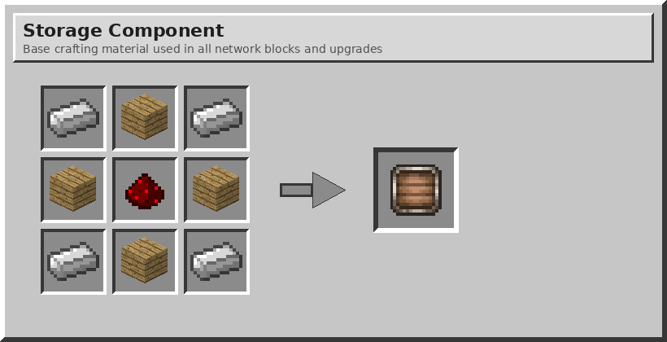

- **Ingredients:** 4x Iron Ingots, 4x Wooden Chests, 1x Redstone Dust.
- **Yield:** 1x Storage Component.

---

### Storage Heart

The central core of your storage network. Contains a 20-slot inventory for crafting stations, emits Light Level 15, and manages network storage.

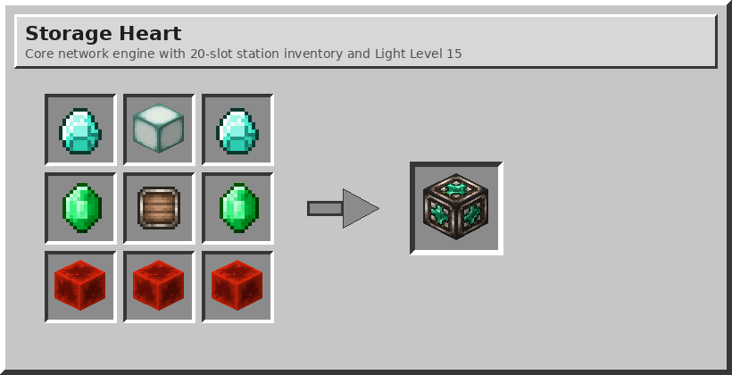

- **Ingredients:** 2x Diamonds, 1x Sea Lantern, 2x Emeralds, 1x Storage Component, 3x Redstone Blocks.
- **Yield:** 1x Storage Heart.

---

### Storage Access Terminal

The access terminal for browsing, searching, sorting, depositing, and withdrawing network items.

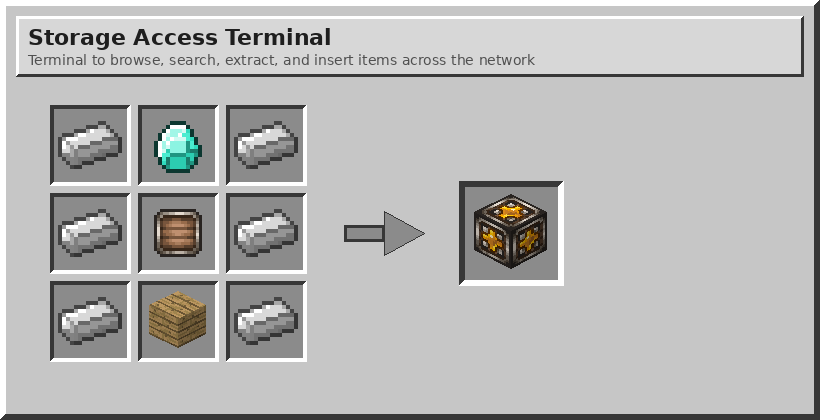

- **Ingredients:** 7x Iron Ingots, 1x Diamond, 1x Storage Component, 1x Wooden Chest.
- **Yield:** 1x Storage Access.

---

### Crafting Access Interface

The crafting terminal connected to your network. Provides a 3x3 crafting grid with multi-station mechanics and 3-state autofill.

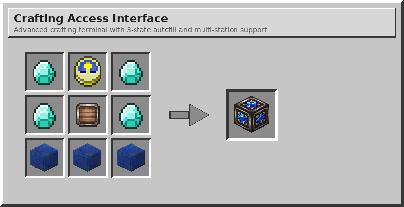

- **Ingredients:** 4x Diamonds, 1x Clock, 1x Storage Component, 3x Lapis Lazuli Blocks.
- **Yield:** 1x Crafting Access Interface.

---

### Remote Storage Access Block

The physical anchor block required to link wireless portable remotes to your Storage Heart network.

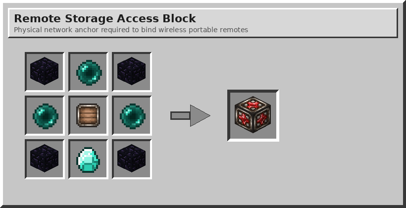

- **Ingredients:** 4x Obsidian, 3x Ender Pearls, 1x Storage Component, 1x Diamond.
- **Yield:** 1x Remote Storage Access Block.

---

### Hell Bricks (x8)

A defensive and building block. Ignites entities standing on it for 3 seconds unless protected by Fire Resistance.

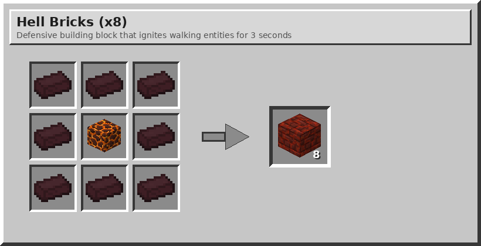

- **Ingredients:** 8x Nether Bricks, 1x Magma Block.
- **Yield:** 8x Hell Bricks.

---

## 2. Storage Units (8 Tiers)

Storage Units can be crafted directly using a lower-tier unit with its tier upgrade, or upgraded in-place in the world.

| Storage Unit | Stack Capacity | Row Count | Direct Crafting Recipe |
| :--- | :---: | :---: | :--- |
| **Basic Storage Unit** | **36 Slots** | 4 Rows | 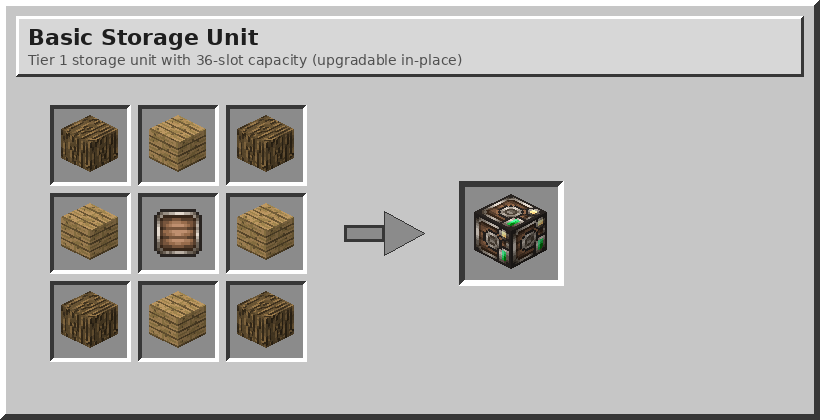 |
| **Crimtane Storage Unit** | **54 Slots** | 6 Rows | 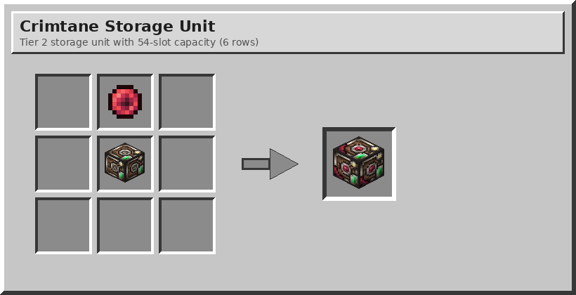 |
| **Demonite Storage Unit** | **54 Slots** | 6 Rows | 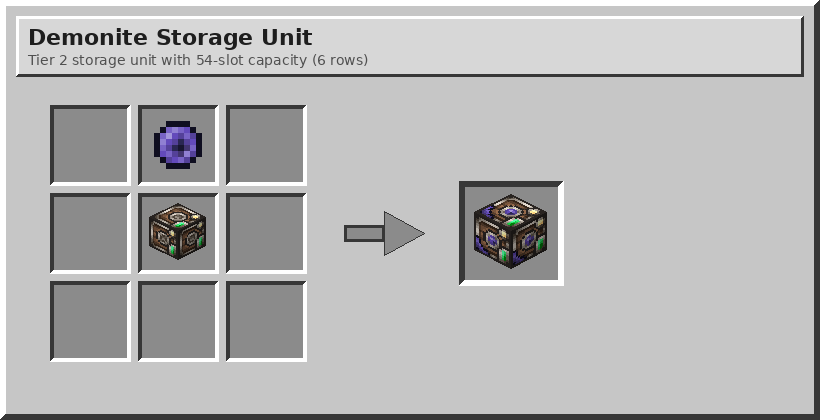 |
| **Hellstone Storage Unit** | **90 Slots** | 10 Rows | 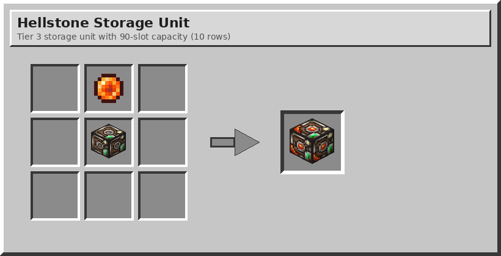 |
| **Hallowed Storage Unit** | **135 Slots** | 15 Rows | 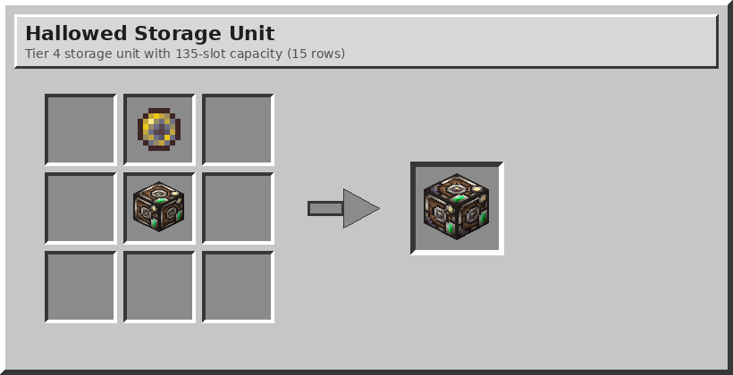 |
| **Blue Chlorophyte Unit** | **180 Slots** | 20 Rows | 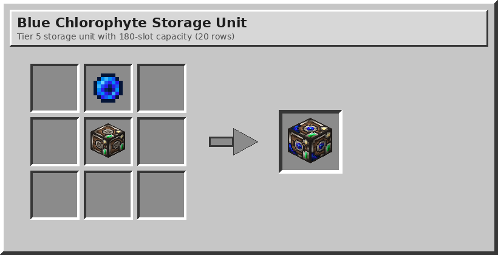 |
| **Luminite Storage Unit** | **252 Slots** | 28 Rows | 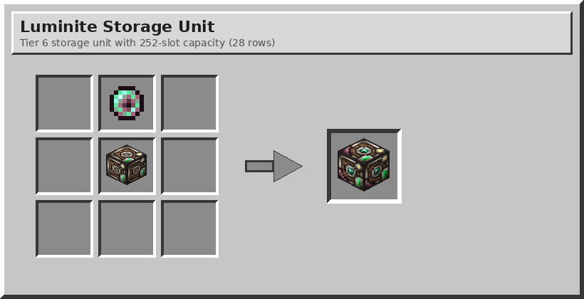 |
| **Terra Storage Unit** | **360 Slots** | 40 Rows | 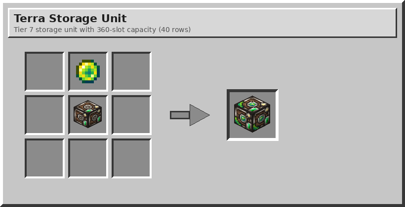 |

---

## 3. Storage Upgrades

Hold an upgrade item and **Right-Click** any lower-tier storage unit in the world to upgrade it in-place without losing items.

### Crimtane Storage Upgrade (Target: 54 slots / 6 rows)

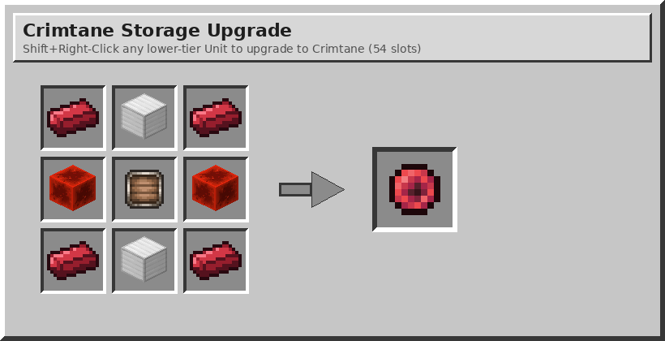

- **Ingredients:** 4x Crimtane Ingots, 2x Iron Blocks, 2x Redstone Blocks, 1x Storage Component.

### Demonite Storage Upgrade (Target: 54 slots / 6 rows)

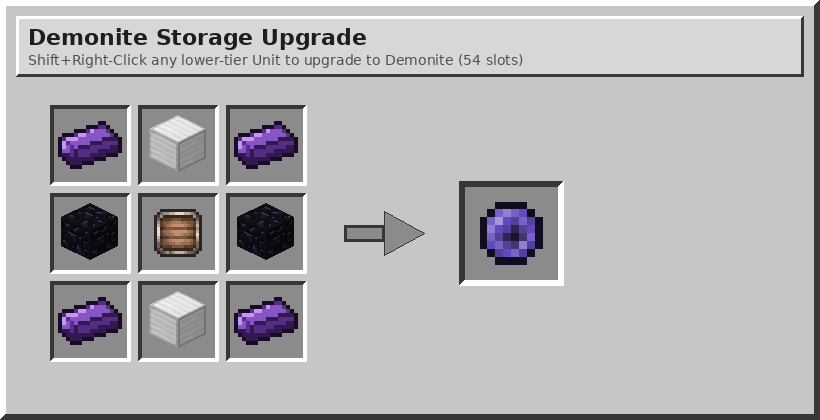

- **Ingredients:** 4x Demonite Ingots, 2x Iron Blocks, 2x Obsidian, 1x Storage Component.

### Hellstone Storage Upgrade (Target: 90 slots / 10 rows)

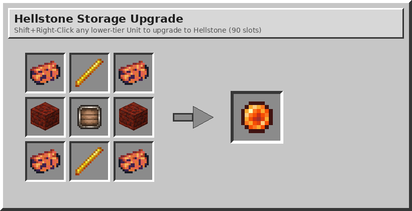

- **Ingredients:** 4x Hellstone Bars, 2x Blaze Rods, 2x Hell Bricks, 1x Storage Component.

### Hallowed Storage Upgrade (Target: 135 slots / 15 rows)

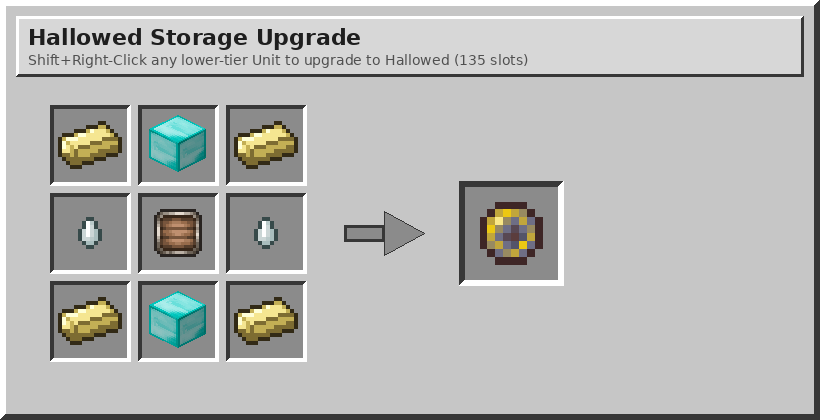

- **Ingredients:** 4x Hallowed Ingots, 2x Diamond Blocks, 2x Ghast Tears, 1x Storage Component.

### Blue Chlorophyte Storage Upgrade (Target: 180 slots / 20 rows)

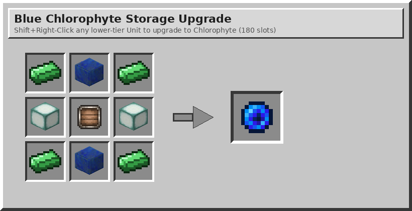

- **Ingredients:** 4x Chlorophyte Bars, 2x Lapis Blocks, 2x Sea Lanterns, 1x Storage Component.

### Luminite Storage Upgrade (Target: 252 slots / 28 rows)

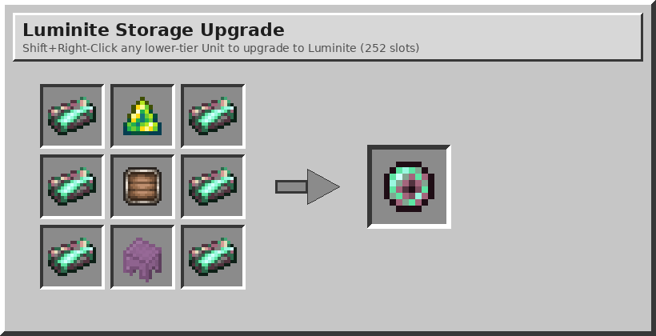

- **Ingredients:** 6x Luminite Bars, 1x Radiant Jewel (slot 2), 1x Shulker Shell (slot 8), 1x Storage Component.

### Terra Storage Upgrade (Target: 360 slots / 40 rows)

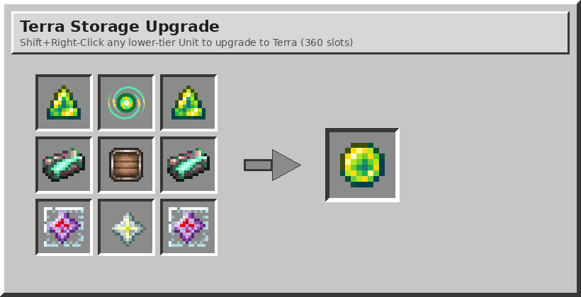

- **Ingredients:** 1x Terra Singularity, 2x Radiant Jewels, 2x Luminite Bars, 1x Nether Star, 2x End Crystals, 1x Storage Component.

---

## 4. Progression Materials, Ores & Jewels

### Shadow Diamond

A dark, abyssal diamond infused with Demonite and Crimtane magic. Used to craft Basic Portable Access remotes.

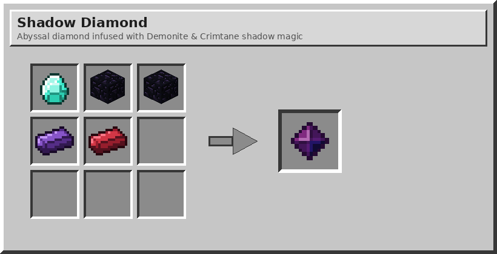

- **Ingredients:** 1x Diamond, 2x Obsidian, 1x Demonite Ingot, 1x Crimtane Ingot (Shapeless).

### Radiant Jewel

A celestial prism radiating stellar energy from Luminite and the End. Used in Ultimate Portable Access remotes, Luminite Storage Upgrades, and Terra Storage Upgrades.

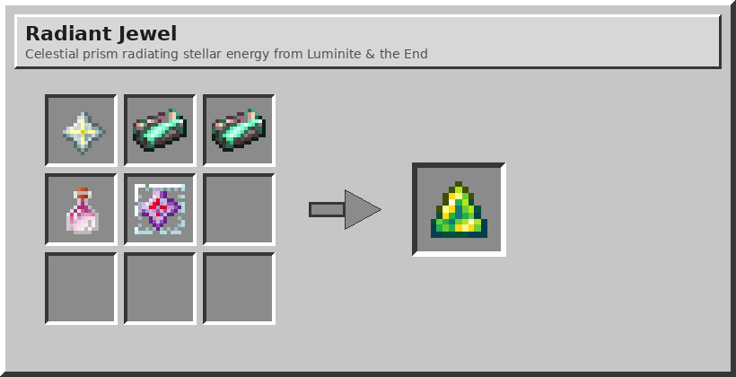

- **Ingredients:** 1x Nether Star, 2x Luminite Bars, 1x Dragon's Breath, 1x End Crystal (Shapeless).

### Terra Singularity

The ultimate cosmic synthesis of all six metal tiers and endgame bosses. Used to forge Terra Storage Upgrades and Ultimate Portable Crafting Remotes.

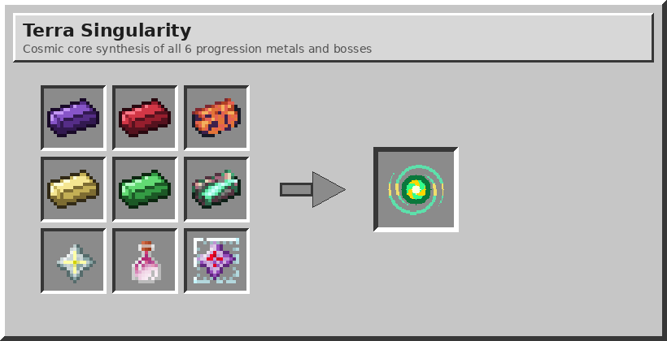

- **Ingredients:** 1x Demonite Ingot, 1x Crimtane Ingot, 1x Hellstone Bar, 1x Hallowed Ingot, 1x Chlorophyte Bar, 1x Luminite Bar, 1x Nether Star, 1x Dragon's Breath, 1x End Crystal (Shapeless).

### Hellstone Ore & Hellstone Bar

- **World Generation:** Generates in the **Nether** deep beneath the lava ocean level (**strictly Y < 31**, depths Y: 5–30) embedded in Netherrack.
- **Harvesting:** Mining drops **Hellstone Fragments** with **Fortune** enchantment scaling (or drops the block with Silk Touch). Smelting the ore in a furnace yields fragments as well.
- **Forging:** Must be forged in a **Storage Heart with a Furnace** inside its station inventory.

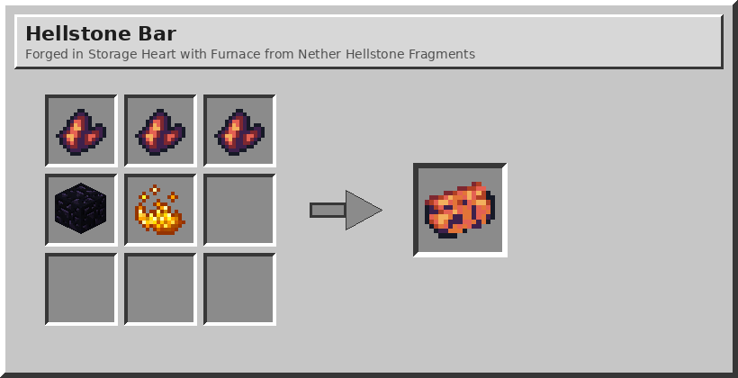

- **Ingredients:** 3x Hellstone Fragments, 1x Obsidian, 1x Blaze Powder (Heart with Furnace).

### Luminite Ore & Luminite Bar

- **World Generation:** Generates in the **End** on outer islands (**distance $\ge$ 1,024 blocks** from the central island) embedded in End Stone.
- **Harvesting:** Mining drops **Luminite Fragments** with **Fortune** enchantment scaling (or drops the block with Silk Touch). Smelting the ore in a furnace yields fragments as well.
- **Forging:** Must be forged in a **Storage Heart with a Furnace** inside its station inventory.

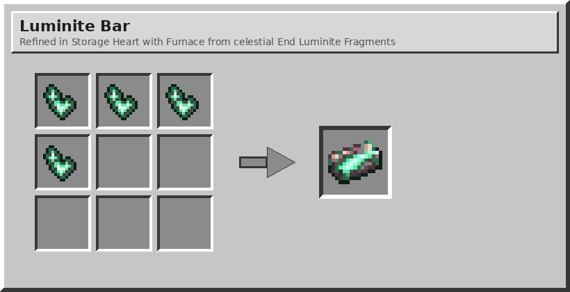

- **Ingredients:** 4x Luminite Fragments (Heart with Furnace).

### Hallowed Ingot (x2)

A sacred alloy radiating holy energy. Used for Hallowed Storage Upgrades and Advanced Remotes.

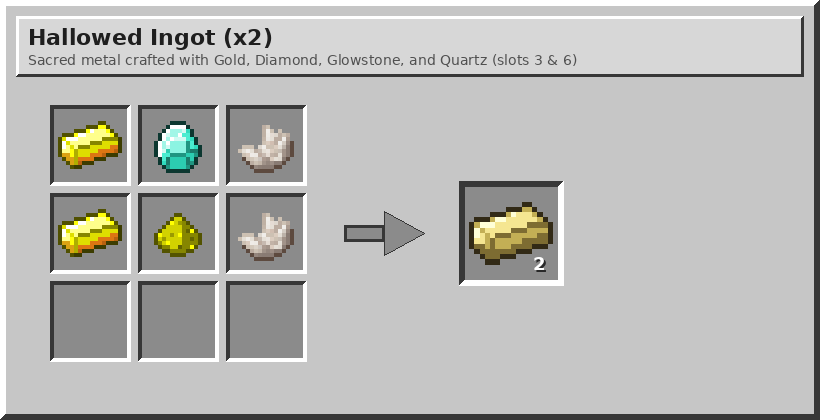

- **Ingredients:** 2x Gold Ingots, 1x Diamond, 1x Glowstone Dust, 2x Nether Quartz placed in slots 3 & 6 (Shaped).
- **Yield:** 2x Hallowed Ingots.

### Chlorophyte Bar (x2)

A living botanical alloy used for Blue Chlorophyte Storage Upgrades.

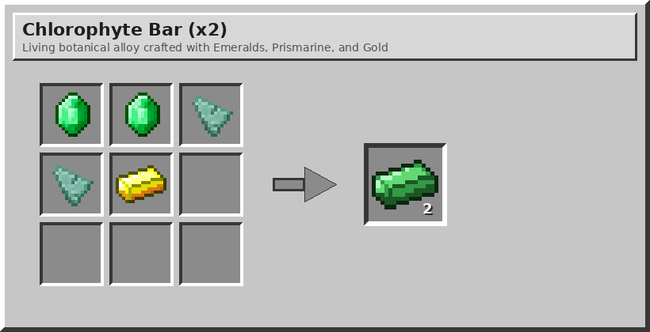

- **Ingredients:** 2x Emeralds, 2x Prismarine Shards, 1x Gold Ingot (Shapeless).
- **Yield:** 2x Chlorophyte Bars.

### Crimtane Ingot (x2)

Flesh-carved metal forged from iron, redstone, and Nether wart.

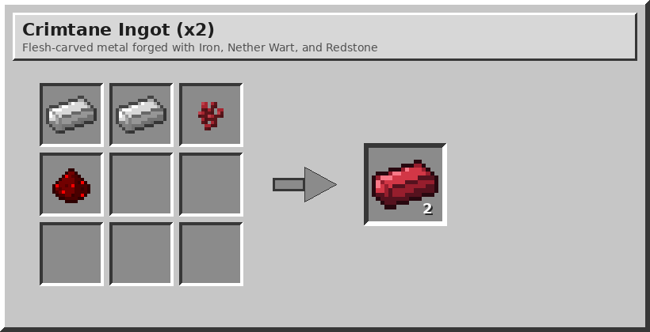

- **Ingredients:** 2x Iron Ingots, 1x Nether Wart, 1x Redstone Dust (Shapeless).
- **Yield:** 2x Crimtane Ingots.

### Demonite Ingot (x2)

Shadow-infused metal forged from iron, obsidian, and ender pearls.

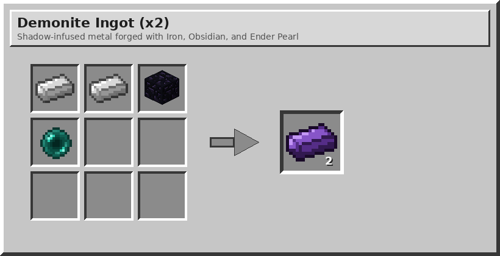

- **Ingredients:** 2x Iron Ingots, 1x Obsidian, 1x Ender Pearl (Shapeless).
- **Yield:** 2x Demonite Ingots.

---

## 5. Portable Storage Remotes

Wireless remotes for browsing and managing items. Bind by **Sneak+Right-Clicking** a placed **Remote Storage Access** block.

### Basic Portable Storage Access (PreHM)

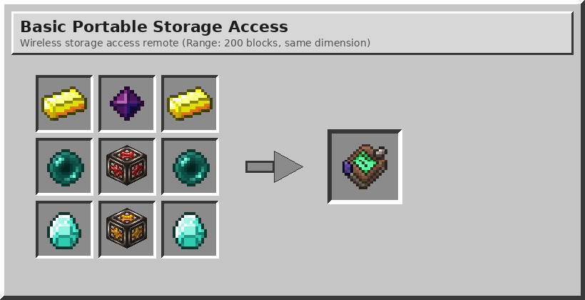

- **Range:** 200 blocks (same dimension).
- **Ingredients:** 2x Gold Ingots, 1x Shadow Diamond, 2x Ender Pearls, 1x Remote Access Block, 2x Diamonds, 1x Storage Access Terminal.

### Advanced Portable Storage Access (HM)

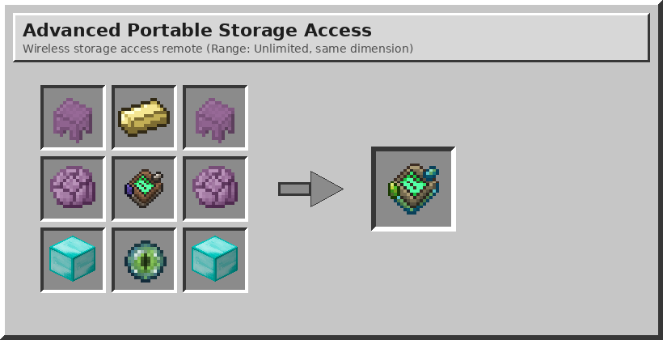

- **Range:** Unlimited (same dimension).
- **Ingredients:** 2x Shulker Shells, 1x Hallowed Ingot, 2x Popped Chorus Fruit, 1x Basic Portable Access Remote, 2x Diamond Blocks, 1x Eye of Ender.

### Ultimate Portable Storage Access

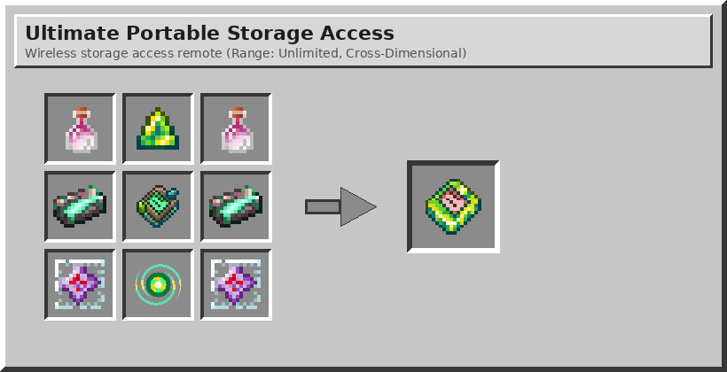

- **Range:** Unlimited across **all dimensions**.
- **Ingredients:** 2x Dragon's Breath, 1x Radiant Jewel, 2x Luminite Bars, 1x Advanced Portable Access Remote, 2x End Crystals, 1x Terra Singularity.

---

## 6. Portable Crafting Remotes

Wireless remotes with full 3x3 crafting grid and station support. Bind by **Sneak+Right-Clicking** a placed **Remote Storage Access** block. Can also be created by combining a Storage Remote with a Crafting Table.

### Basic Portable Crafting Access (PreHM)

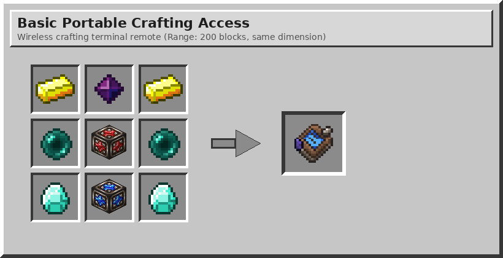

- **Range:** 200 blocks (same dimension).
- **Ingredients:** 2x Gold Ingots, 1x Shadow Diamond, 2x Ender Pearls, 1x Remote Access Block, 2x Diamonds, 1x Crafting Access Interface.

### Advanced Portable Crafting Access (HM)

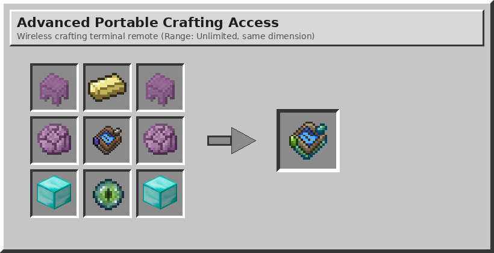

- **Range:** Unlimited (same dimension).
- **Ingredients:** 2x Shulker Shells, 1x Hallowed Ingot, 2x Popped Chorus Fruit, 1x Basic Portable Crafting Remote, 2x Diamond Blocks, 1x Eye of Ender.

### Ultimate Portable Crafting Access

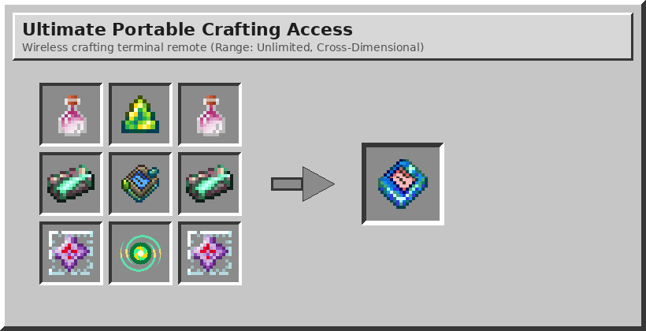

- **Range:** Unlimited across **all dimensions**.
- **Ingredients:** 2x Dragon's Breath, 1x Radiant Jewel, 2x Luminite Bars, 1x Advanced Portable Crafting Remote, 2x End Crystals, 1x Terra Singularity.

---

## 7. Dynamic Station Demonstrations

The **Crafting Access** dynamically reads all crafting station items placed inside the **Storage Heart's 20-slot inventory**.

### Furnace Smelting Demonstration
- **Station in Heart:** Furnace
- **Layout:** Center slot (Slot 5) holds fuel; outer slots (Slots 1-4, 6-9) hold identical smeltable inputs.
- **Mechanics:** Smelt ticks are dynamically calculated (200 ticks per item). Fuel is consumed probabilistically: $\frac{\text{Inputs} \times 200}{\text{Single Fuel Burn Ticks}}$.

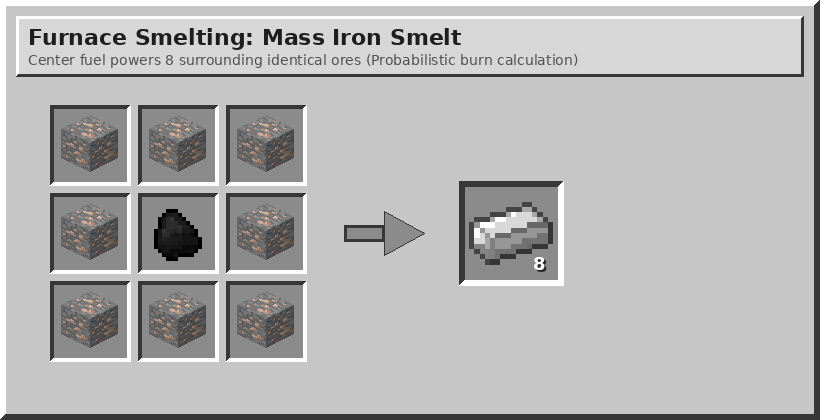

---

### Enchanting Table Demonstration
- **Station in Heart:** Enchanting Table
- **Layout:** Slot 1 holds the unenchanted item; Slots 4, 5, and 6 hold Lapis Lazuli.
- **Bookshelf Power:** Automatically scanned and calculated from all bookshelf items inside your network storage.

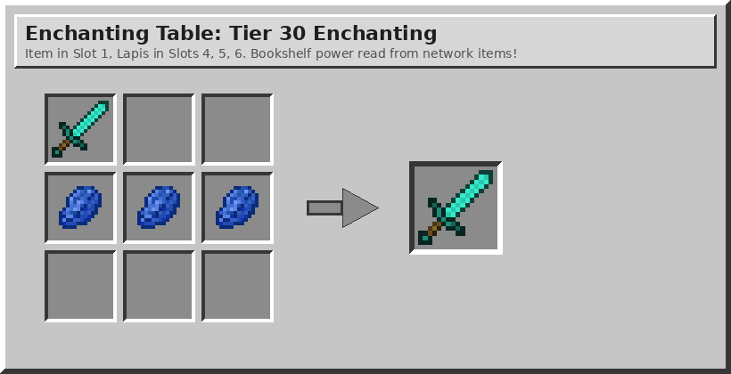

---

### Anvil Repair & Combination Demonstrations
- **Station in Heart:** Anvil
- **Layout:** Slot 1 holds the primary item; Slot 5 holds the repair material or secondary enchanted book.
- **Mechanics:** Calculates authentic vanilla repair durability, enchantment combining math, and XP level costs.

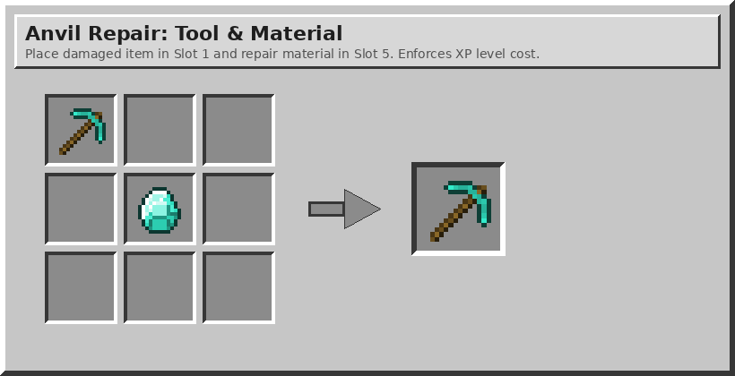

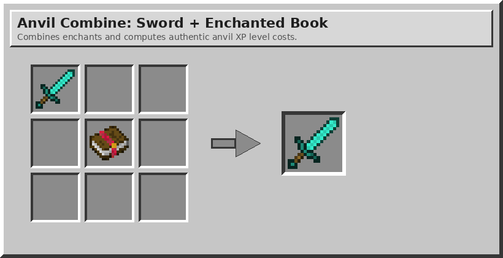

---

### Brewing Stand Demonstration
- **Station in Heart:** Brewing Stand
- **Layout:** Slot 1 holds Blaze Powder, Slot 2 holds ingredient, Slots 4, 5, 6 hold water/potion bottles.

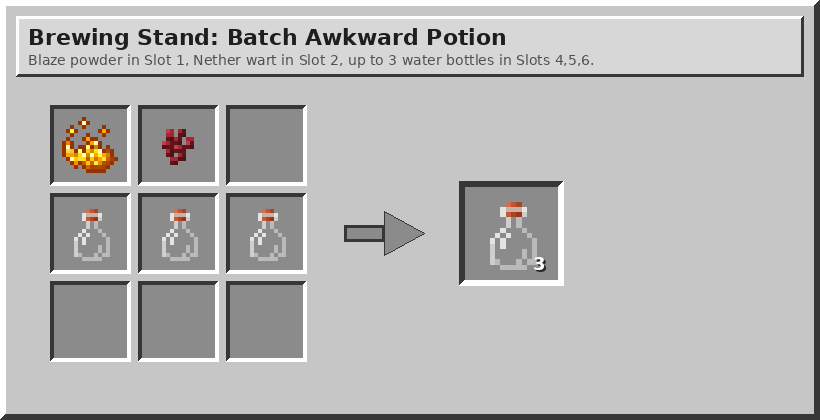

---

### Modded Stations (Rustic, Disenchanter, Bountiful Baubles, Quality Tools)

All modded crafting stations placed inside the Storage Heart automatically unlock their recipes in the Crafting Access:

#### Rustic Alchemy: Simple & Advanced
- **Stations in Heart:** Condenser + Retorts (Simple or Advanced).
- **Mechanics:** Enforces burn-time tick minimums (400 ticks Simple / 300 ticks Advanced). Water buckets return empty buckets to storage when autofill is enabled.

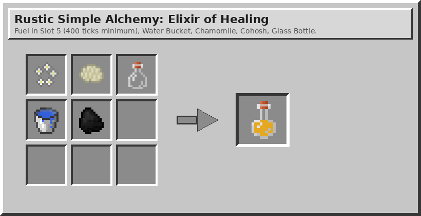

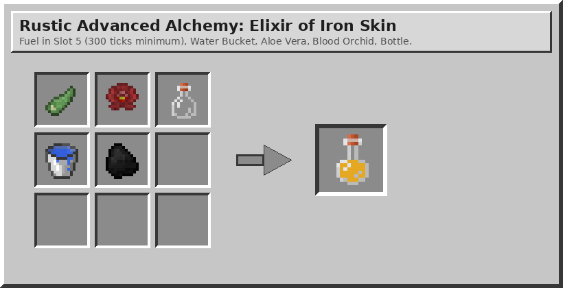

#### Rustic Brewing Barrel & Crushing Tub
- **Brewing Barrel:** Place fruits in Slot 1 and optional modifier wine in Slot 5 to preserve wine quality.
- **Crushing Tub:** Place 4x fruits (Grapes/Wildberries) in Slot 1 and an Empty Bottle in Slot 5. Enforces 4-fruit batch consumption.

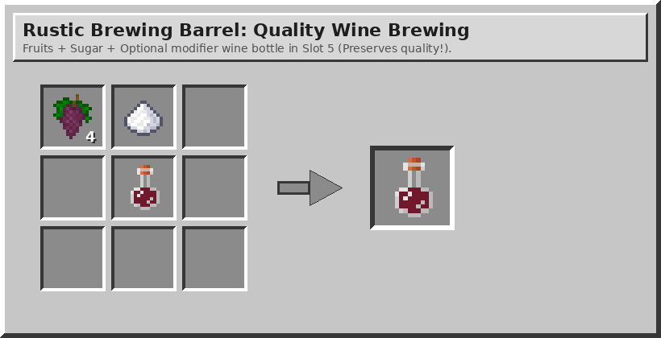

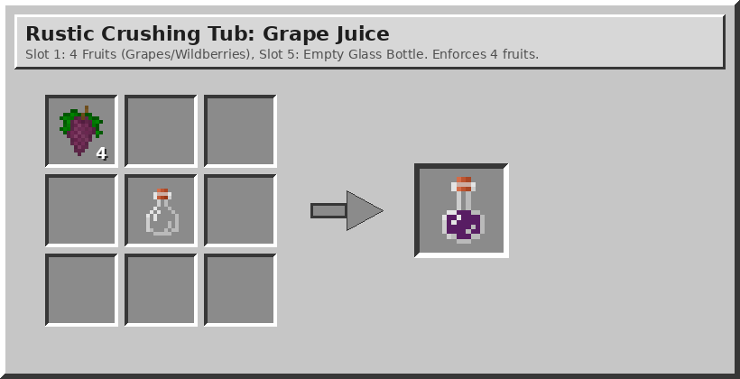

#### Disenchanter Table
- **Station in Heart:** Disenchantment Table.
- **Layout:** Slot 5 holds the enchanted item; Slot 3 holds a regular book. Extracts enchantments onto the book.

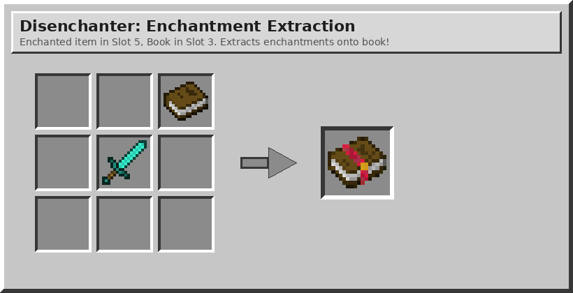

#### Reforgers (Bountiful Baubles & Quality Tools)
- **Bountiful Baubles Reforger:** Place bauble in Slot 9. Reforges modifier attributes using player XP levels.
- **Quality Tools Reforging Station:** Place tool/armor/bauble in Slot 5 and reforging material in Slot 9. Dynamically supports all dynamic materials.

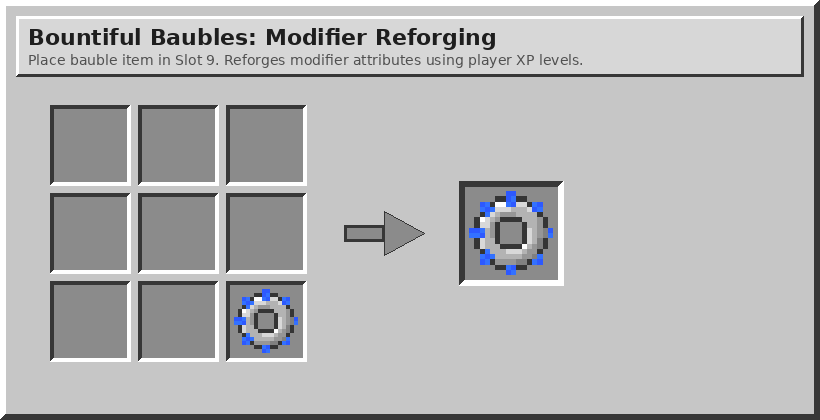

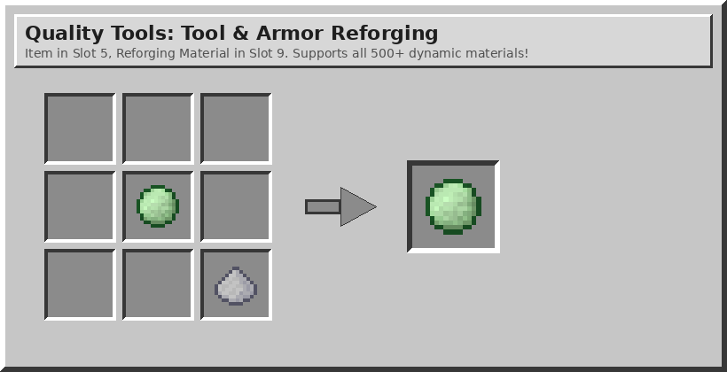

---

[← Back to Wiki Hub](../README.md) | [Main Documentation](../../README.md)
